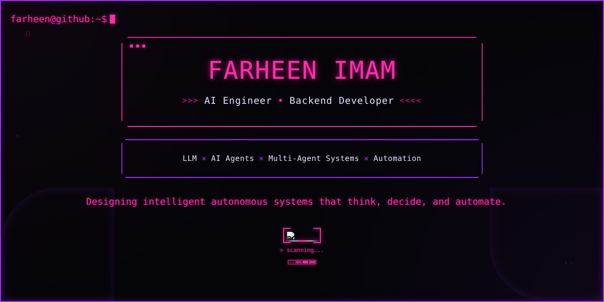
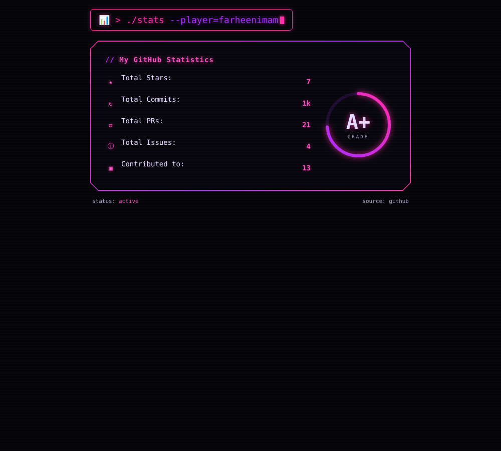
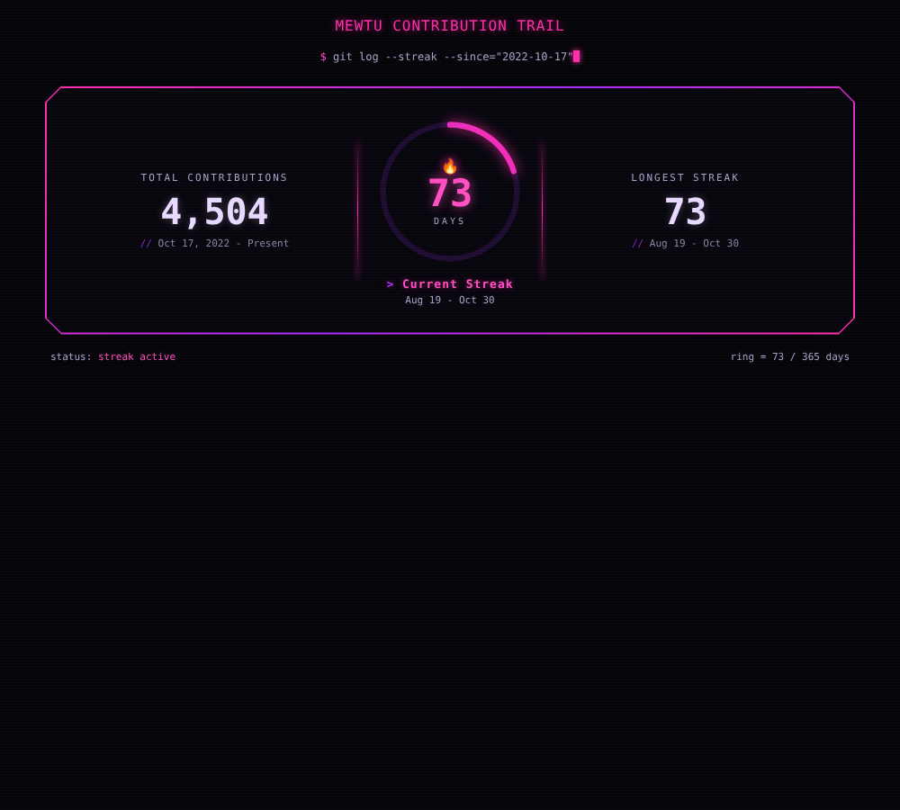
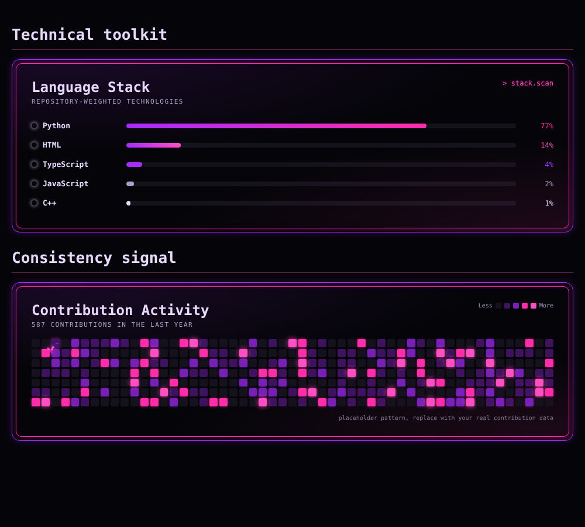
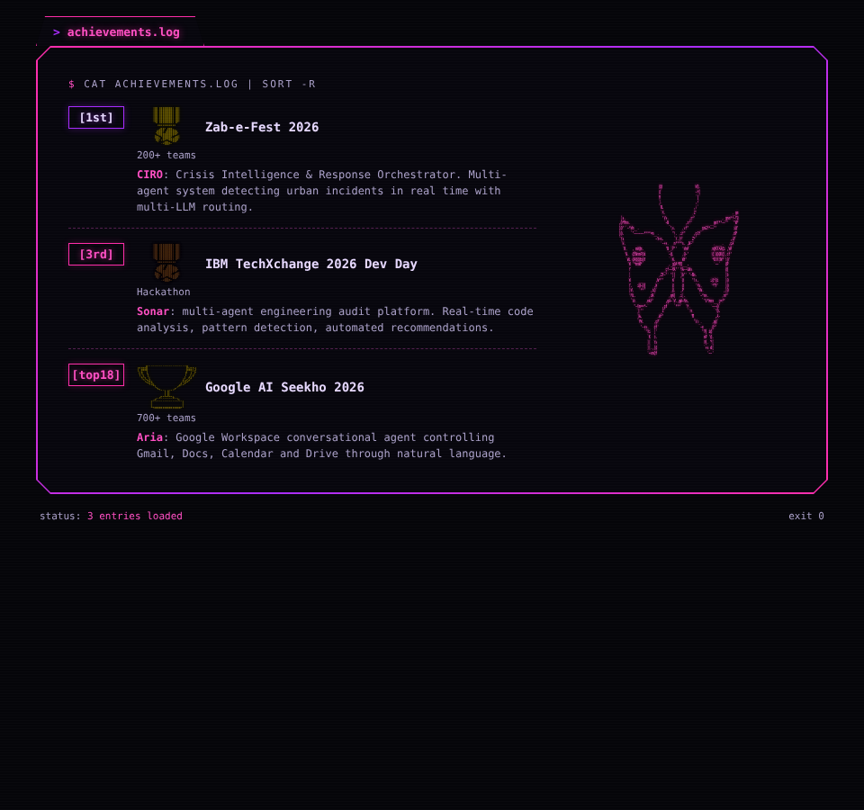
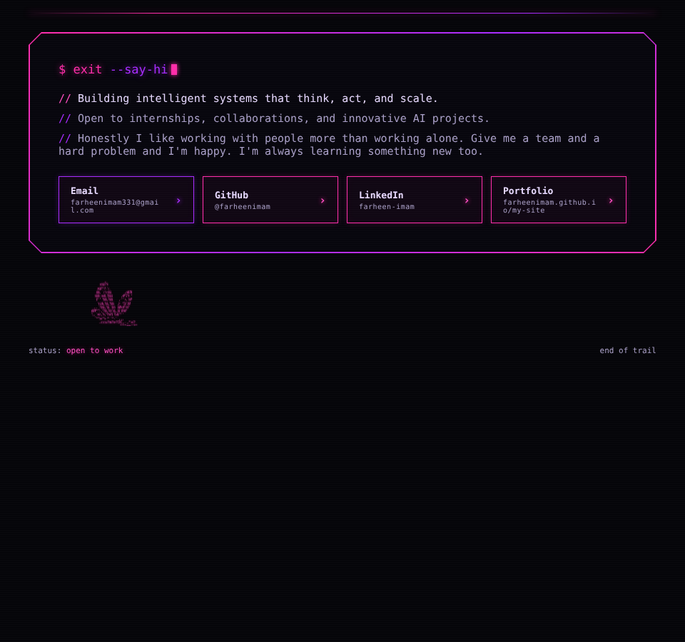

<div align="center">

<a href="https://farheenimam.github.io/"></a>

[](https://farheenimam.github.io/)
[](https://www.linkedin.com/in/farheen-imam-686356280/)
[](mailto:farheenimam.offically@gmail.com)

</div>


# Farheen Imam: AI Engineer & Backend Developer


# Who I Am

I'm an **AI Engineer** focused on **LLM-powered agents, multi-agent systems, and automation**. I build the backend that runs them, from tool-calling and orchestration to APIs and deployment.

I don't just build demos. I build **systems that think, decide, and automate**.


# What I Do

## AI Agent Engineering
* Build agents with **LangGraph** (stateful graphs, conditional routing, human-in-the-loop) and **Google ADK** (orchestrator and sub-agent architectures)
* Tool calling and **MCP** (Model Context Protocol) integrations
* Memory, planning, and multi-step reasoning across tools
* Multi-LLM routing across **Claude**, **Gemini**, and **OpenAI**

## Automation Engineering
* Multi-step workflows with **n8n** and custom Python tooling
* Connect APIs, event triggers, and AI decision logic end to end
* Scheduled pipelines with **GitHub Actions**

## Backend for AI Systems
* REST APIs with **FastAPI**, **Flask**, and **Spring Boot**
* Vector search, embeddings, and model inference pipelines
* Containerized deployment with **Docker**


# Tech Stack

<div align="center">

### AI, Agents & Orchestration


### Backend Engineering


### DevOps & Cloud


### Languages


</div>


# Selected Projects

### Sonar: Multi-Agent Engineering Audit Platform
* **Stack:** Python, multi-agent orchestration, IBM Bob
* **What it does:** Real-time code analysis, pattern detection, and automated recommendations. 3rd place, IBM TechXchange 2026 Dev Day.

### CIRO: Crisis Intelligence & Response Orchestrator
* **Stack:** Python, Claude, Gemini, GPT-4, multi-LLM routing
* **What it does:** Multi-agent system detecting urban incidents in real time. 1st place, Zab-e-Fest 2026 (200+ teams).

### Aria: Google Workspace Agent
* **Stack:** Google ADK, Gemini 2.5 Pro, Google Agent Builder
* **What it does:** Conversational agent controlling Gmail, Docs, Calendar, and Drive through natural language. Top 18, AI Seekho 2026 (700+ teams).

### Agent-Driven Job Recommender
* **Stack:** Python, OpenAI, n8n, Flask, MySQL
* **What it does:** Harvests job data from APIs, ranks and personalizes using an agent, and automates notifications.

### Hackify: Hackathon Aggregator
* **Stack:** FastAPI, PWA, Supabase, GitHub Actions
* **What it does:** Tracks 7+ hackathon platforms with automated scraping every 4 hours.


# Currently

```python
farheen = {
    "learning": ["LangGraph state machines", "Google ADK multi-agent patterns", "MCP tool servers"],
    "building": ["Agentic workflows", "Scalable backend systems for AI products"],
    "interested_in": ["Agent evaluation", "Tool-use reliability", "Process automation"],
    "available_for": ["Hackathons", "Collaborations", "AI engineering roles"]
}
```


# GitHub Stats

<a href="https://farheenimam.github.io/stats-github.html"></a>

<a href="https://farheenimam.github.io/stats-streak.html"></a>

<a href="https://farheenimam.github.io/stats-panels.html"></a>


# Achievements

<a href="https://farheenimam.github.io/achievements.html"></a>


# Collaboration

Open for:
* Hackathons
* Agent-based product ideas
* AI engineering roles
* Open-source collaboration

<div align="center">

[](mailto:farheenimam.offically@gmail.com)
[](https://www.linkedin.com/in/farheen-imam-686356280/)
[](https://farheenimam.onrender.com/)

</div>


# Say Hi

<a href="https://farheenimam.github.io/readme-closing.html"></a>


<div align="center">

### *"Automate the predictable. Innovate the intelligent."*


</div>
